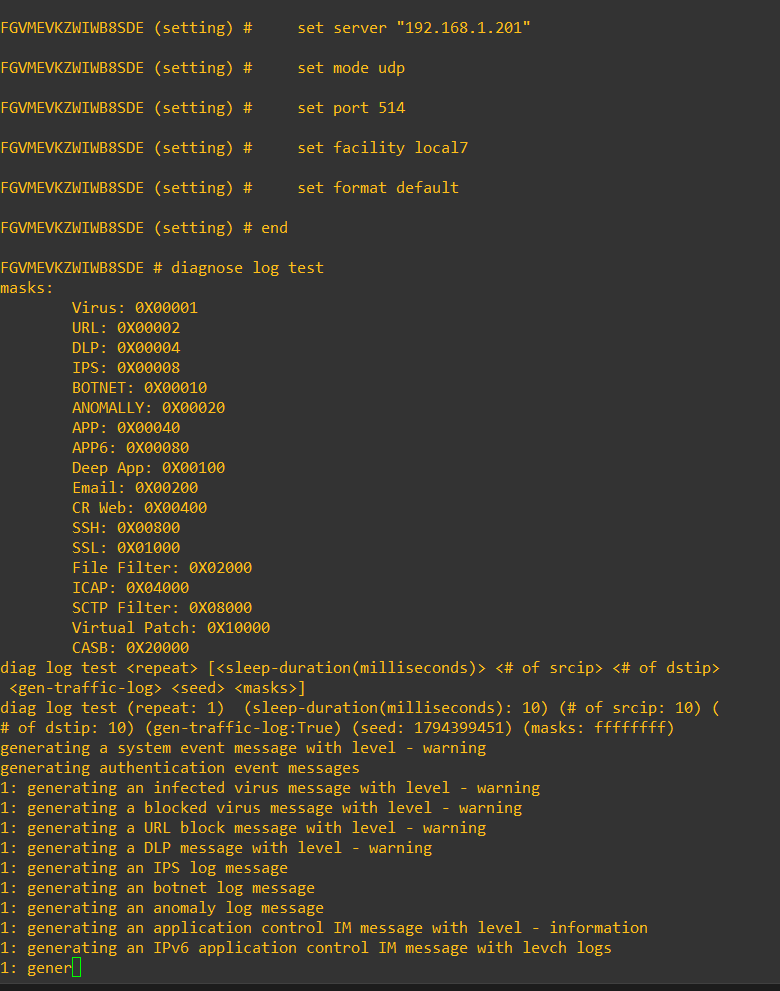
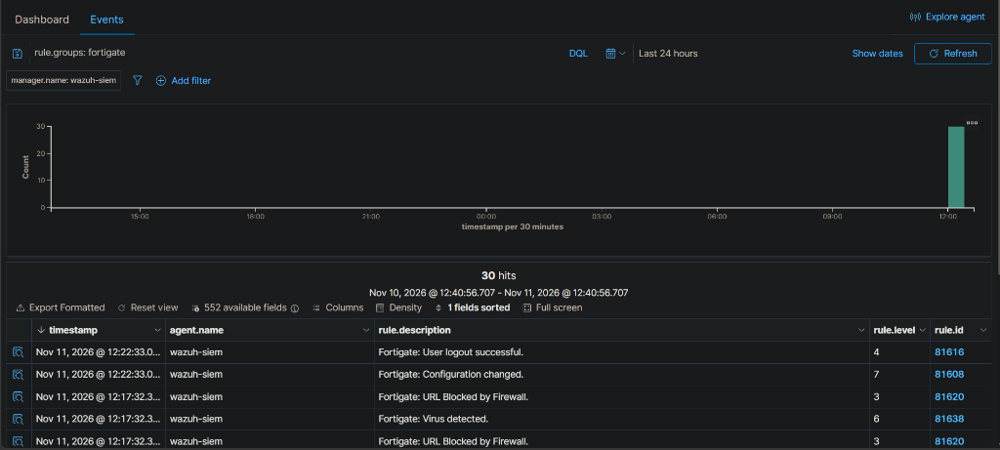
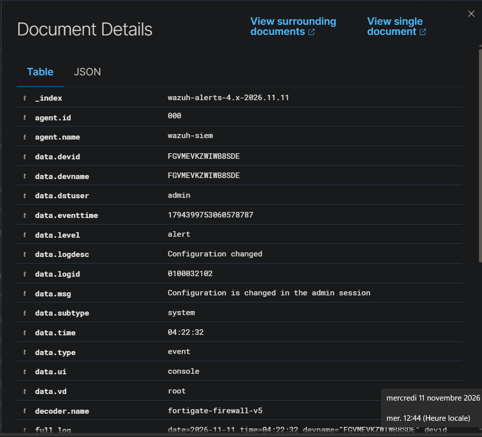
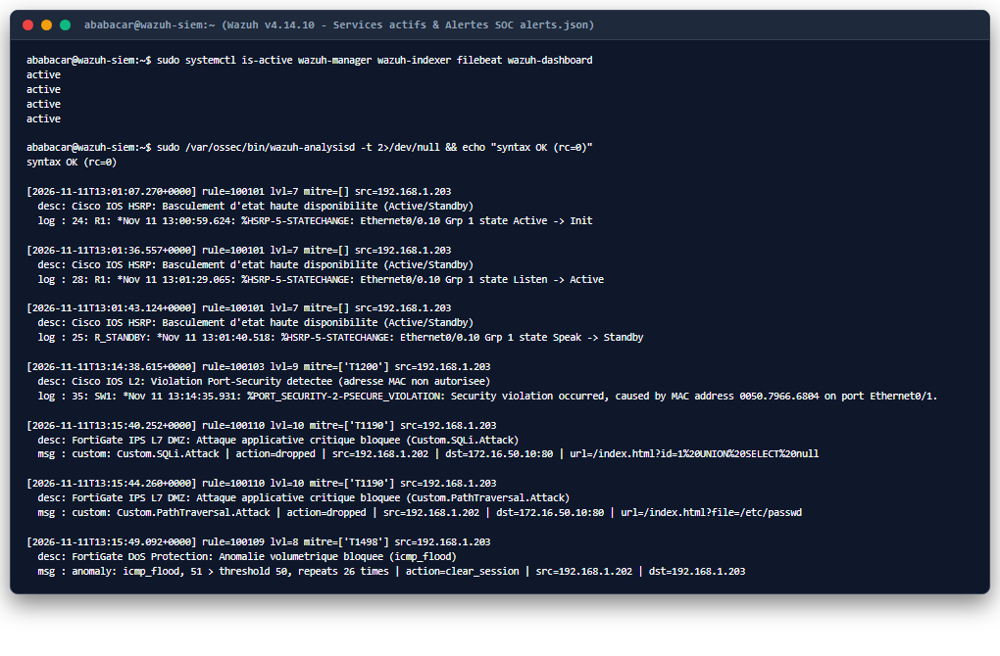
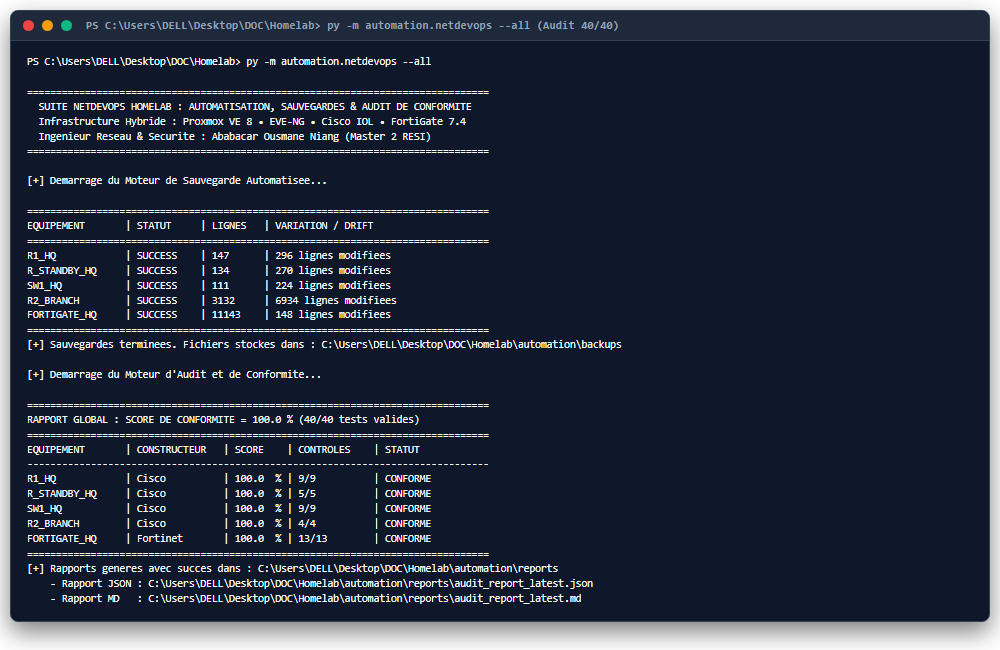

# GUIDE 13 : PALIER 8 - SUPERVISION CENTRALISEE, CORRELATION SOC & SIEM WAZUH

Ce guide documente l'implementation de reference du **Palier 8** d'Ingenierie Cybersecurite & Observabilite : le deploiement d'une plateforme **SIEM (*Security Information and Event Management*)** centralisee sous **Wazuh v4.14.10**, l'acheminement structure des journaux Syslog multi-constructeurs (Fortinet FortiGate 7.4.13 et Cisco IOS L2/L3), la redaction de **10 regles de correlation SOC personnalisees** mappees au referentiel **MITRE ATT&CK**, et la validation sur incidents reels couples a l'audit NetDevOps a **40 points de controle (100.0 %)**.

---

## 1. Contexte et Enjeux Industriels d'un SOC / SIEM Centralise

Meme avec un durcissement avance sur les couches L2 (Port-Security, DHCP Snooping, BPDU Guard), L3 (OSPFv2, HSRP) et L7 (IPS DPI, Application Control, Anti-DDoS), une infrastructure reseau reste aveugle face aux incidents si la telemetrie demeure dispersee dans la memoire volatile locale des equipements :
1. **Volatilite des journaux locaux :** Sur FortiGate-VM sans disque dedie ou sur routeurs Cisco IOS, un redemarrage ou une rotation de buffer en RAM entraine la perte definitive des traces d'attaque.
2. **Absence de correlation transversale :** Une tentative d'intrusion sur un port d'acces (`SW1`), un basculement de passerelle (`R1`/`R_STANDBY`) et une rafale HTTP sur la DMZ (`FORTIGATE_HQ`) ne peuvent etre relies chronologiquement sans horloge synchronisee et collecteur unique.
3. **Qualification des signaux faibles :** Sans regles de detection dediees et classification par criticite, les alertes critiques de niveau 2 ou les signatures IPS personnalisees restent noyees au sein du trafic administratif ordinaire.

Le **Palier 8** repond a ces exigences en unifiant l'observabilite securite de l'ensemble du Homelab dans **Wazuh v4.14.10** (Indexer OpenSearch, Filebeat TLSv1.2 et Wazuh Dashboard).

---

## 2. Architecture du Plan d'Adressage Fixe & Pipeline SIEM

A ce stade de maturite, les noeuds critiques d'infrastructure ont ete figes en **adressage IP statique deterministe** afin de fiabiliser la collecte Syslog, les tunnels IPsec et l'automatisation NetDevOps.

```text
+------------------------------------------------------------------------------------------------------+
|                          RESEAU D'ADMINISTRATION & INTERCONNEXION (192.168.1.0/24)                   |
|                                                                                                      |
|  [ PROXMOX VE Bare-Metal ]         [ VM 101 : WAZUH SIEM v4.14.10 ]         [ VM 200 : EVE-NG ]      |
|        192.168.1.200                        192.168.1.201                     192.168.1.202          |
|                                     Collecteur Syslog UDP/514                                        |
|                                  Indexer OpenSearch (:9200 TLS)                                      |
|                                   Dashboard SOC (:443 HTTPS)                                         |
+--------------------------------------------------+---------------------------------------------------+
                                                   ^
                      Flux Syslog UDP/514          |           Flux Syslog UDP/514 (via NAT / WAN)
                      +----------------------------+-----------------------------+
                      |                                                          |
+---------------------+----------------------+              +--------------------+---------------------+
|      FORTIGATE_HQ (FortiOS 7.4.13)         |              |      CISCO R2-BRANCH (IOL L3 15.5)       |
|  - port1 WAN : 192.168.1.203/24            |   IKEv2 /    |  - e0/0 WAN : 192.168.1.250/24           |
|  - port2 LAN : 172.16.1.1/30 (OSPF Area 0) |<-- IPsec --->|  - e0/1 LAN : 192.168.20.1/24            |
|  - port3 DMZ : 172.16.50.254/24            |              |  - Syslog   : origin-id hostname         |
+---------------------+----------------------+              +------------------------------------------+
                      |
                      | Transit OSPFv2 (172.16.1.0/30)
                      v
+---------------------+----------------------+              +------------------------------------------+
|         CISCO R1 (HSRP Active - Prio 110)  |              |    CISCO R_STANDBY (HSRP Standby - 100)  |
|  - e0/0.10 : 10.10.10.1/24                 |<--- HSRP --->|  - e0/0.10 : 10.10.10.2/24               |
|  - VIP     : 10.10.10.254 (VMAC 0c07.ac01) |   Groupe 1   |  - Route   : 0.0.0.0/0 -> 10.10.10.1     |
+---------------------+----------------------+              +--------------------+---------------------+
                      |                                                          |
                      +----------------------------+-----------------------------+
                                                   v
+--------------------------------------------------+---------------------------------------------------+
|                               COMMUTATEUR D'ACCES DURCI CISCO SW1                                    |
|  - Management SVI Vlan10 : 10.10.10.10/24 | Passerelle : 10.10.10.254 (HSRP VIP)                     |
|  - Route statique explicite : ip route 0.0.0.0 0.0.0.0 10.10.10.254 (pour trafic Syslog local)       |
|  - Securite Et0/1 : Port-Security (Sticky, Restrict), DHCP Snooping VLAN 10, BPDU Guard              |
+------------------------------------------------------------------------------------------------------+
```

### Matrice Finale d'Adressage Statique du Homelab

| Equipement | Role / Systeme | Interface / Acces | Adresse IP Statique | Passerelle / Cible SIEM |
| :--- | :--- | :--- | :--- | :--- |
| **Proxmox VE** | Hyperviseur Bare-Metal KVM | `vmbr0` (`:8006`) | `192.168.1.200/24` | `192.168.1.1` |
| **Wazuh SIEM** | VM 101 — Serveur SIEM & SOC (`v4.14.10`) | `eth0` (UDP `514`, HTTPS `443`) | `192.168.1.201/24` | Collecteur Central SOC |
| **EVE-NG** | VM 200 — Plateforme d'Emulation Reseau | `pnet0` (HTTP/SSH) | `192.168.1.202/24` | `192.168.1.1` |
| **FORTIGATE_HQ** | NGFW Fortinet (`FortiOS 7.4.13`) | `port1` WAN / `port2` / `port3` DMZ | `192.168.1.203/24` / `172.16.1.1` / `172.16.50.254` | Syslog -> `192.168.1.201` |
| **R1** | Routeur Campus HQ (OSPF + HSRP Active) | `e0/0.10` / `e0/1` | `10.10.10.1/24` / `172.16.1.2/30` | Syslog -> `192.168.1.201` |
| **R_STANDBY** | Routeur Secours Campus (HSRP Standby) | `e0/0.10` | `10.10.10.2/24` (`VIP .254`) | Syslog -> `192.168.1.201` |
| **SW1** | Commutateur Acces Campus L2 Durci | `Vlan10` (`MGMT_L2_SW1`) | `10.10.10.10/24` | `10.10.10.254` -> `192.168.1.201` |
| **R2-BRANCH** | Routeur Succursale Distante (IPsec IKEv2) | `e0/0` WAN / `e0/1` LAN | `192.168.1.250/24` / `192.168.20.1/24` | Syslog -> `192.168.1.201` |
| **SRV-WEB-DMZ** | Serveur Web Alpine Linux 3.20 (DMZ) | `eth0` (HTTP port `80`) | `172.16.50.10/24` (`VIP :8080`) | `172.16.50.254` |

---

## 3. Configuration du Serveur SIEM Wazuh v4.14.10 (`192.168.1.201`)

### A. Activation du Collecteur Syslog UDP/514

Le moteur d'analyse `wazuh-remoted` est configure dans `/var/ossec/etc/ossec.conf` afin d'ecouter simultanement les agents natifs (`1514/tcp`) et les flux Syslog reseau non-agents (`514/udp`) provenant des trois sous-reseaux d'infrastructure :

```xml
<ossec_config>
  <remote>
    <connection>secure</connection>
    <port>1514</port>
    <protocol>tcp</protocol>
    <queue_size>131072</queue_size>
  </remote>

  <remote>
    <connection>syslog</connection>
    <port>514</port>
    <protocol>udp</protocol>
    <allowed-ips>192.168.1.0/24</allowed-ips>
    <allowed-ips>10.10.10.0/24</allowed-ips>
    <allowed-ips>172.16.1.0/24</allowed-ips>
  </remote>
</ossec_config>
```

### B. Verification de la Chaine d'Indexation (`Filebeat -> OpenSearch`)

L'ensemble des quatre briques critiques du SIEM a ete verifie a l'etat `active` sous systemd (`wazuh-manager`, `wazuh-indexer`, `filebeat`, `wazuh-dashboard`), et la sortie TLSv1.2 de Filebeat vers `https://127.0.0.1:9200` alimente en temps reel l'index journalier `wazuh-alerts-4.x-2026.11.11`.

---

## 4. Configuration de l'Export Syslog Multi-Constructeurs

### A. Pare-feu Fortinet FortiGate 7.4 (`192.168.1.203`)

L'export Syslog et la synchronisation horaire (fuseau `Africa/Dakar` / NTP) sont actives en CLI FortiOS vers le serveur SIEM :

```fortios
config system global
    set timezone "Africa/Dakar"
end

config system ntp
    set ntpsync enable
end

config log syslogd setting
    set status enable
    set server "192.168.1.201"
    set mode udp
    set port 514
    set facility local7
    set format default
end
```


*Figure 8.1 : Activation CLI de l'export Syslog UDP/514 vers `192.168.1.201` sur FortiGate 7.4 et generation des journaux de verification via `diagnose log test`.*

### B. Equipements Cisco IOL (`R1`, `R_STANDBY`, `SW1`, `R2-BRANCH`)

Sur chaque noeud Cisco IOS, la directive `logging origin-id hostname` est ajoutee afin d'inscrire explicitement le nom d'hote dans l'en-tete Syslog avant traversée NAT du pare-feu, complétée par la directive `logging source-interface`.

**Routeurs Campus `R1` et `R_STANDBY` :**
```cisco
logging origin-id hostname
logging source-interface Ethernet0/0.10
logging host 192.168.1.201
```

**Routeur Succursale `R2-BRANCH` :**
```cisco
logging origin-id hostname
logging source-interface Ethernet0/0
logging host 192.168.1.201
```

**Commutateur d'Acces `SW1` (Contournement routage L2/L3 IOL) :**
```cisco
interface Vlan10
 description MGMT_L2_SW1
 ip address 10.10.10.10 255.255.255.0
 exit
ip default-gateway 10.10.10.254
ip route 0.0.0.0 0.0.0.0 10.10.10.254
logging origin-id hostname
logging source-interface Vlan10
logging host 192.168.1.201
```

### C. Specificites d'Architecture Rencontrees et Resolues

Deux contraintes reelles d'exploitation ont ete diagnostiquees et resolues lors de la mise en service :
1. **Acheminement depuis un commutateur IOL L2 (`SW1`) :** L'image Cisco IOL L2 activant la pile de routage (`ip routing`), la commande classique `ip default-gateway` est ignoree pour le trafic genere localement par le plan de controle (tels que les datagrammes Syslog UDP/514). L'ajout de la route par defaut explicite `ip route 0.0.0.0 0.0.0.0 10.10.10.254` ciblant la VIP HSRP a immediatement retabli l'envoi vers le SIEM.
2. **Respect du quota de licence FortiOS (`vdom-max = 3`) :** La licence d'evaluation permanente plafonne le pare-feu a 3 politiques de filtrage actives (`LAN_TO_INTERNET`, `CORP_INTERNAL_INTERZONE`, `WAN_TO_DMZ_VIP`). L'export Syslog des equipements internes (`10.10.10.0/24`) vers `192.168.1.201` emprunte donc la politique `LAN_TO_INTERNET` avec NAT dynamique sur `port1` (`192.168.1.203`). C'est pourquoi Wazuh consigne `location: 192.168.1.203`, tandis que le champ `origin-id` preleve par `cisco-ios` restaure sans ambiguite l'identite `R1`, `R_STANDBY` ou `SW1`.

---

## 5. Ingenierie des Regles de Correlation SOC & Mapping MITRE ATT&CK

Le referentiel personnalise [`automation/wazuh/local_rules.xml`](../automation/wazuh/local_rules.xml) est deploye dans `/var/ossec/etc/rules/local_rules.xml`. Il tire parti d'une analyse rigoureuse des decodeurs Wazuh natifs (`cisco-ios` et `fortigate-firewall-v5`) :
- **Hierarchie des regles Cisco :** Dans le ruleset standard Wazuh (`0025-cisco-ios_rules.xml`), la regle racine `4700` est evaluee au niveau `0`, tandis que les regles filles `4712` a `4716` classifient les logs par severite Syslog (`2` = Critical -> `4712`, `3` = Error -> `4713`, `4` = Warning -> `4714`, `5` = Notification -> `4715`, `6` = Info -> `4716`). Le ciblage precis `<if_sid>4712</if_sid>` a `4716` associe aux champs extraits `cisco.facility` et `cisco.mnemonic` garantit le declenchement deterministe des alertes.
- **Hierarchie des regles FortiGate :** Nos regles etendent `81630` (Anomalies DoS) et `81629` (IPS) en filtrant directement sur `subtype` (`^anomaly$`) et `attack` (`^Custom\.`), tout en enrichissant dynamiquement la description via `$(attack)`.

### Catalogue des 10 Regles SOC Deployees (`100101` - `100110`)

| Rule ID | Niveau | Parent (`if_sid`) | Equipement / Source | Condition & Contexte Technique | Technique MITRE ATT&CK |
| :--- | :---: | :--- | :--- | :--- | :--- |
| **`100101`** | **7** | `4715` | `R1` / `R_STANDBY` | `cisco.facility = HSRP` et `STATECHANGE` | Haute Disponibilite (`FHRP`) |
| **`100102`** | **7** | `4715` | `R1` / `R_STANDBY` | `cisco.facility = OSPF` et `ADJCHG` | Integrite Routage Dynamique |
| **`100103`** | **9** | `4712` | `SW1` (Acces L2) | `cisco.facility = PORT_SECURITY` | **`T1200`** (*Hardware Additions*) |
| **`100104`** | **8** | `4714` | `SW1` (Acces L2) | `cisco.facility = PM` et `ERR_DISABLE` | Mise en quarantaine L2 |
| **`100105`** | **8** | `4713-4716` | `SW1` (Acces L2) | `cisco.facility = DHCP_SNOOPING` | **`T1557`** (*AiTM / Rogue DHCP*) |
| **`100106`** | **7** | `4712-4715` | `SW1` (Acces L2) | `cisco.facility = SPANTREE` (BPDU Guard) | Integrite Spanning-Tree |
| **`100107`** | **5** | `4713, 4715` | Parc Cisco IOS | `LINEPROTO` ou `LINK` UP/DOWN | Supervision Liaisons |
| **`100108`** | **5** | `4715, 4716` | `R2-BRANCH` | `CRYPTO` ou `IKEV2` (Tunnel IPsec) | Tunnel VPN Site-a-Site |
| **`100109`** | **8** | `81630` | `FORTIGATE_HQ` | `subtype = anomaly` (`icmp_flood`, `syn_flood`) | **`T1498`** (*Network DoS*) |
| **`100110`** | **10** | `81629` | `FORTIGATE_HQ` | `attack` commencant par `Custom.` (SQLi / LFI) | **`T1190`** (*Exploit Public App*) |

---

## 6. Campagne de Tests d'Incidents Reels & Preuves SIEM

### A. Inspection dans l'Interface Web Wazuh Threat Hunting & OpenSearch

L'interface Web **Wazuh Threat Hunting** (`https://192.168.1.201`) confirme la reception continue des journaux FortiOS decodes par `fortigate-firewall-v5` (ex. modification de configuration `81608`, URL/Virus bloques `81620`/`81638`, session administrateur `81616`) et leur indexation structuree champ par champ dans OpenSearch.


*Figure 8.2 : Tableau de bord Wazuh Threat Hunting filtre par DQL `rule.groups: fortigate` montrant les evenements pare-feu indexes en temps reel.*


*Figure 8.3 : Vue Document Details confirmant l'index `_index: wazuh-alerts-4.x-2026.11.11`, le decodeur `fortigate-firewall-v5` et l'extraction normalisee des champs `data.devname`, `data.logdesc` et `data.subtype`.*

### B. Scenario 1 : Basculement Haute Disponibilite HSRP (`Rule 100101`)

Un test de basculement a chaud (`shutdown` puis `no shutdown` sur `R1 Ethernet0/0.10`) a genere instantanement 3 alertes correlees de niveau 7 dans `/var/ossec/logs/alerts/alerts.json` :
- `2026-11-11T13:01:07.270+0000` : `R1` passe de `Active -> Init`
- `2026-11-11T13:01:36.557+0000` : `R1` reprend l'etat `Listen -> Active` par preemption (priorite 110)
- `2026-11-11T13:01:43.124+0000` : `R_STANDBY` bascule de `Speak -> Standby`

### C. Scenario 2 : Attaque L2 Port-Security (`Rule 100103`, MITRE `T1200`)

Sur le commutateur `SW1`, l'adresse autorisee sur `Ethernet0/1` a ete basculee temporairement sur une adresse statique fictive (`0000.1111.2222`, apres purge de l'entree dynamique sticky via `no switchport port-security`). Lorsque le poste `VPCS` (`MAC 0050.7966.6804`) a tente un `ping 10.10.10.254` :
- Les paquets ont ete bloques au niveau L2 (`Security Violation Count : 3` en mode `restrict`).
- Wazuh a leve a `2026-11-11T13:14:38.615+0000` l'alerte **Rule `100103` (niveau 9, MITRE `T1200`)** identifiant la MAC non autorisee `0050.7966.6804` sur `Ethernet0/1`.
- Le port a ensuite ete restaure proprement en mode `sticky` avec l'adresse legitime et sauvegarde (`write memory`).

### D. Scenario 3 : Cyberattaques L7 DMZ & Flood DoS WAN (`Rules 100110` & `100109`)

Apres deploiement du service Web HTTP DMZ sur `SRV-WEB-DMZ` (`172.16.50.10:80`) et validation nominale (`curl http://192.168.1.203:8080/` -> `HTTP/1.0 200 OK`), trois vecteurs d'attaque reels ont ete lances depuis l'exterieur (`192.168.1.202`) :

| Vecteur d'Attaque | Commande de Test | Action FortiGate | Alerte Wazuh (`alerts.json`) | Criticite & MITRE |
| :--- | :--- | :--- | :--- | :--- |
| **Injection SQL (URI)** | `curl "...?id=1%20UNION%20SELECT%20null"` | `dropped` (`IPS_SENSOR_DMZ`, ID `3900`) | **Rule `100110`** (`13:15:40.252+0000`) | Niveau **10** (`T1190`) |
| **Path Traversal** | `curl "...?file=/etc/passwd"` | `dropped` (`IPS_SENSOR_DMZ`, ID `2906`) | **Rule `100110`** (`13:15:44.260+0000`) | Niveau **10** (`T1190`) |
| **Inondation ICMP** | `ping -c 70 -i 0.01 -W 1 192.168.1.203` | `clear_session` (`DOS_WAN_PROTECT`, seuil `50`) | **Rule `100109`** (`13:15:49.092+0000`) | Niveau **8** (`T1498`) |


*Figure 8.4 : Preuve directe depuis le serveur `wazuh-siem` des services actifs, de la validation syntaxique `wazuh-analysisd` et des 7 alertes SOC reelles enregistrees dans `/var/ossec/logs/alerts/alerts.json`.*

---

## 7. Extension NetDevOps : Audit Automatique a 40 Points (100.0 %)

Afin d'eviter toute regression entre la couche reseau, la haute disponibilite HSRP et la supervision SIEM, la suite Python [`automation/`](../automation) a ete etendue :
1. **Inventaire complet a 5 noeuds (`config.py`) :** Integration du routeur secondaire `R_STANDBY_HQ`, passage aux adresses fixes definitives (`.200` a `.203`) et declaration de `expected_hsrp` et `expected_syslog_host` (`192.168.1.201`).
2. **Nouveaux controles programmatiques (`audit_engine.py`) :**
   - Verification de l'etat HSRP Groupe 1 (`Active` sur `R1_HQ`, `Standby` sur `R_STANDBY_HQ`, VIP `10.10.10.254`).
   - Controle de la directive `logging host 192.168.1.201` sur les 4 equipements Cisco.
   - Controle `show log syslogd setting` (`set status enable` et `192.168.1.201`) sur `FORTIGATE_HQ`.
3. **Referentiel SOC versionne (`automation/wazuh/local_rules.xml`) :** Archivage local des regles XML aux cotes des sauvegardes de configuration.

### Resultats de l'Execution NetDevOps (`py -m automation.netdevops --all`)

| Equipement | Constructeur | Role Infrastructure | Controles | Score | Statut |
| :--- | :--- | :--- | :---: | :---: | :--- |
| **`R1_HQ`** | Cisco | Routeur Campus HQ / HSRP Active VLAN 10 | `9 / 9` | `100.0 %` | **CONFORME** |
| **`R_STANDBY_HQ`** | Cisco | Routeur Secours Campus HQ / HSRP Standby | `5 / 5` | `100.0 %` | **CONFORME** |
| **`SW1_HQ`** | Cisco | Commutateur Acces Campus HQ (Durci L2) | `9 / 9` | `100.0 %` | **CONFORME** |
| **`R2_BRANCH`** | Cisco | Routeur Succursale Distante (IPsec IKEv2) | `4 / 4` | `100.0 %` | **CONFORME** |
| **`FORTIGATE_HQ`** | Fortinet | NGFW & Passerelle Perimetrique HQ | `13 / 13` | `100.0 %` | **CONFORME** |
| **TOTAL PARC** | **Multi-Constructeurs** | **5 Equipements / Collecteur SIEM `192.168.1.201`** | **`40 / 40`** | **`100.0 %`** | **CONFORME** |


*Figure 8.5 : Execution reelle de `py -m automation.netdevops --all` validant la sauvegarde a chaud des 5 equipements et le score global de conformite de 100.0 % (40/40 points).*

---

## 8. Bilan d'Ingenierie et Competences Validees

Le Palier 8 couronne la chaine de valeur du laboratoire en unifiant prevention, detection et gouvernance automatisee :
1. **Observabilite SOC Unifiee :** 100 % des equipements de campus, de succursale et de perimetre convergent en temps reel vers le SIEM Wazuh v4.14.10.
2. **Detection Active & MITRE ATT&CK :** Les attaques L2 (`T1200`, `T1557`), L4 (`T1498`), L7 (`T1190`) et les basculements FHRP sont automatiquement qualifies, horodates et indexes.
3. **Zero Drift & Conformite Continue :** La suite NetDevOps garantit par audit automatise (40/40) que chaque equipement reste en permanence conforme a l'etat d'ingenierie de reference et connecte au SIEM.
